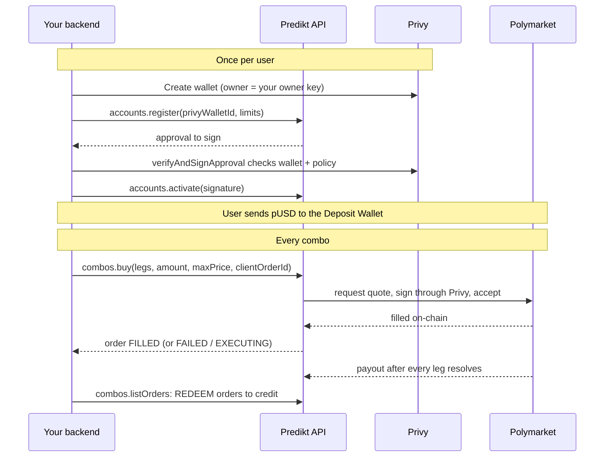

# Integration guide: Polymarket Combos on Privy wallets

A step-by-step guide for backend developers integrating `@prediktgg/sdk` to offer **Polymarket Combos** (parlays) to their users, using **Privy wallets you own**. Follow the steps in order. For every method and error code see the [README](https://github.com/4-point-0/predikt-sdk#direct-trading-and-polymarket-combos-server-side); for the REST reference see the Privy Wallets, Combos and Direct Trading pages of the Predikt documentation.

> [!IMPORTANT]
> Everything in this guide runs **on your server**. It needs a **backend** API key, your Privy App Secret and your owner key. Never ship any of them to a browser or mobile app.

## Contents

1. [What you need](#1-what-you-need)
2. [How it fits together](#2-how-it-fits-together)
3. [Install and configure](#3-install-and-configure)
4. [Connect your Privy app (once)](#4-connect-your-privy-app-once)
5. [Onboard a user's wallet (once per user)](#5-onboard-a-users-wallet-once-per-user)
6. [Fund the Deposit Wallet](#6-fund-the-deposit-wallet)
7. [Show markets and a price](#7-show-markets-and-a-price)
8. [Buy a combo](#8-buy-a-combo)
9. [Track orders and settle](#9-track-orders-and-settle)
10. [Cash out (optional)](#10-cash-out-optional)
11. [Payouts](#11-payouts)
12. [Rules your code must follow](#12-rules-your-code-must-follow)
13. [Errors](#13-errors)
14. [Renewing and changing limits](#14-renewing-and-changing-limits)
15. [Regular markets (direct trading)](#15-regular-markets-direct-trading)
16. [Go-live checklist](#16-go-live-checklist)

## 1. What you need

| Item | Where it comes from | Notes |
| --- | --- | --- |
| Predikt **backend** API key (`sk_predikt_...`) and API base URL | Predikt | A frontend key gets `403 FORBIDDEN` on these routes |
| Privy app: **App ID** and **App Secret** | Privy dashboard | Send the App Secret to Predikt through the agreed secure channel. Until Predikt has configured it, calls return `500 INTERNAL_ERROR` |
| **Owner key**: a Privy authorization key (P-256), registered as a key quorum | Privy dashboard → authorization keys | The private key (`wallet-auth:...`) stays on your server. It owns every user wallet and signs approvals |
| Node.js 18+ | — | `@prediktgg/sdk/server` uses `node:crypto` |

**Units.** pUSD (Polymarket's collateral on Polygon) and shares are strings in 6-decimal base units: `"2000000"` = 2 pUSD or 2 shares. Prices are decimal strings between 0 and 1 (`"0.41"`). Never convert base units to a JavaScript `number`; use `toBaseUnits('2.5')` and `fromBaseUnits('2500000')`.

## 2. How it fits together



- The **Privy wallet** is yours (you are its owner). Predikt gets an additional signer on it, limited by a Privy policy to Polymarket logins, Polymarket orders and Deposit Wallet batches, until the grant's `expiresAt`.
- The **Deposit Wallet** is Polymarket's smart wallet for that Privy wallet. It holds the user's pUSD and positions. **Users fund this address**, not the Privy wallet.
- Predikt never holds funds. Removing Predikt's signer from the wallet in Privy revokes access immediately.

## 3. Install and configure

```bash
npm install @prediktgg/sdk
```

```typescript
import { PrediktSDK } from '@prediktgg/sdk';

export const predikt = new PrediktSDK({
  baseUrl: process.env.PREDIKT_API_URL!,
  apiKey: process.env.PREDIKT_API_KEY!,   // backend key
  timeoutMs: 60_000,                      // a combo buy can take 30 s or more
});
```

The SDK retries network errors and transient `5xx` responses on these calls by itself, always with the **same** `clientOrderId`, so a retry can never buy twice.

## 4. Connect your Privy app (once)

```typescript
await predikt.privyApp.connect({ appId: process.env.PRIVY_APP_ID!, environment: 'production' });
const app = await predikt.privyApp.get();   // { appId, environment, status: 'active' }
```

Run it once per environment (for example in a setup script). Repeating it is safe.

## 5. Onboard a user's wallet (once per user)

**5.1 Create the Privy wallet** with Privy's server SDK or REST API: an Ethereum wallet whose `owner_id` is **your owner key quorum id**. Keep its Privy wallet id.

**5.2 Register it, verify the approval, activate:**

```typescript
import { verifyAndSignApproval } from '@prediktgg/sdk/server';

const limits = {
  maxBuyAmountPerOrder: '50000000',        // max 50 pUSD per buy
  expiresAt: '2027-06-30T00:00:00Z',       // grant expiry
};

let account = await predikt.accounts.register({ privyWalletId, ...limits });

if (account.status === 'awaiting_owner_approval') {
  // Checks the approval against Privy itself, then signs it locally with your owner key.
  // Throws ApprovalVerificationError (and signs nothing) if anything is off.
  const signed = await verifyAndSignApproval(account, {
    ownerKey: process.env.PRIVY_OWNER_KEY!,     // "wallet-auth:..." or PEM
    privyAppId: process.env.PRIVY_APP_ID!,
    privyAppSecret: process.env.PRIVY_APP_SECRET!,
    expected: { privyWalletId, ...limits },
  });
  account = await predikt.accounts.activate(account, signed);
}

// account.status === 'active'
await db.users.update(userId, {
  prediktAccountId: account.accountId,               // direct trading
  depositWalletAddress: account.depositWalletAddress, // combos and funding
});
```

| `status` | Meaning | What to do |
| --- | --- | --- |
| `provisioning` | Deposit Wallet still deploying (only if `register` stopped waiting after 2 min) | Call `register` again with the same input |
| `awaiting_owner_approval` | Approval ready, valid for 10 minutes | Verify, sign, activate (as above) |
| `active` | Ready to trade | — |
| `unavailable` | Grant expired, or account suspended | Re-authorize ([section 14](#14-renewing-and-changing-limits)); a suspended account needs Predikt |

> [!WARNING]
> Never sign an approval without `verifyAndSignApproval` (or the same checks done yourself). It is what guarantees that Predikt only gets the narrow, time-limited signer you agreed to.

**What you approve.** Until `expiresAt`, Predikt can sign Polymarket logins and orders, and Deposit Wallet batches with unrestricted inner calls (used for approvals and redemptions). Treat the grant as broad control of the Deposit Wallet's funds for its duration. Predikt checks `maxBuyAmountPerOrder` before signing every buy; for combos it applies to the amount before fees, so the fee (around 3%) can come on top.

## 6. Fund the Deposit Wallet

Show the user `depositWalletAddress` and ask for **pUSD on Polygon**. Check the balance before trading:

```typescript
const portfolio = await predikt.accounts.portfolio(account);
portfolio.balances.pusd;    // tradable, exact on-chain (base units)
portfolio.balances.usdce;   // USDC.e sent by mistake: visible, but not tradable
```

## 7. Show markets and a price

**7.1 Check the account can trade combos** (once after onboarding, and after every re-authorization):

```typescript
const current = await predikt.accounts.get(account);
if (current.activeGrant?.combosEnabled !== true) {
  // null or false: re-authorize once (section 14); combo buys would end FAILED / SIGNING_FAILED
}
```

**7.2 List eligible markets.** A combo has 2–50 legs; each leg is a market and an outcome (`0` = first outcome, usually Yes; `1` = second).

```typescript
const { markets, nextCursor } = await predikt.combos.listMarkets({ limit: 100 });
for (const m of markets) {
  // m.marketId, m.title, m.outcomes[i], m.prices[i] (decimal), m.tags
}
// or: for await (const m of predikt.combos.iterateMarkets()) { ... }
```

**7.3 Show an indicative price:**

```typescript
import type { ComboLeg } from '@prediktgg/sdk';

const legs: ComboLeg[] = [
  { marketId: '682708', outcome: 0 },
  { marketId: '1090496', outcome: 1 },
];
const quote = await predikt.combos.quote({ legs, amount: '2000000' });
quote.indicativePrice;   // "0.366818": product of the leg prices
quote.potentialPayout;   // pUSD paid if every leg wins (1 pUSD per share)
```

The quote is **not binding**. The real price comes from market makers when you buy and is usually a bit higher (spread, fees around 3%, correlation between legs).

## 8. Buy a combo

Reserve the user's funds and store your own order with a `clientOrderId` **before** calling Predikt:

```typescript
import { PrediktConflictError } from '@prediktgg/sdk';

const clientOrderId = `combo-${myOrder.id}`;           // 1–100 chars, unique per order
await db.orders.create({ ...myOrder, clientOrderId, status: 'reserved' });

const maxPrice = Math.min(Number(quote.indicativePrice) * 1.1, 1).toFixed(4);  // max price per share incl. fees

const order = await predikt.combos.buy({
  wallet: account,                    // or the stored depositWalletAddress
  legs,
  amount: '2000000',                  // pUSD budget incl. fees; never exceeded
  maxPrice,
  clientOrderId,
});

await db.orders.update(myOrder.id, { prediktOrderId: order.id, prediktStatus: order.status });
```

The call waits up to about 15 seconds for the fill and returns the order with `status`:

- `FILLED`: done. Debit the user `order.amount` and store `order.comboConditionId` (needed to sell and redeem).
- `FAILED`: nothing was traded. Release the reservation; `order.error.code` says why (see [section 13](#13-errors)).
- `EXECUTING` / `PENDING`: still settling. Keep the reservation and track it ([section 9](#9-track-orders-and-settle)).

> [!TIP]
> Quotes succeed more often with legs priced around 0.4–0.6 from **unrelated** events. Two markets of the same event tend to get `CONTRADICTORY_LEGS`; avoid lottery legs (below ~0.02) and near-certain tickets (total above ~0.85). `NO_QUOTES` is not permanent: the same ticket often fills a minute later (with a new `clientOrderId`).

## 9. Track orders and settle

For an order that came back `EXECUTING` or `PENDING`:

```typescript
import { isComboOrderFinal } from '@prediktgg/sdk';

const latest = await predikt.combos.waitForOrder(order, { timeoutMs: 120_000 });
if (isComboOrderFinal(latest)) {
  await settle(latest);           // FILLED → debit amount; FAILED → release
} else {
  // Still EXECUTING after the timeout: NOT a failure. Keep funds reserved and check again later
  // with predikt.combos.getOrder(order.id), e.g. from a job every few minutes.
}
```

| `status` | Final | What to do |
| --- | --- | --- |
| `PENDING` | No | Poll |
| `EXECUTING` | No | Keep funds reserved; poll `getOrder`. **Never place a replacement order** |
| `FILLED` | Yes | Settle with `amount` |
| `FAILED` | Yes | Release; retry only with a **new** `clientOrderId` |

> [!CAUTION]
> A `FAILED` order can still carry `quotedPrice`, `shares` and `amount` from the quote that was refused. Only ever use the amounts of `FILLED` orders.

## 10. Cash out (optional)

A combo bought through Predikt can be sold back before it resolves:

```typescript
const sale = await predikt.combos.sell({
  wallet: account,
  comboConditionId: boughtOrder.comboConditionId!,
  shares: boughtOrder.shares!,            // base units
  minPrice: '0.30',                       // min net price per share after fees
  clientOrderId: `combo-sell-${mySale.id}`,
});
// FILLED → credit the user sale.amount
```

Market makers quote whole hundredths of a share, so a full cash-out can leave about 0.008 shares in the wallet.

## 11. Payouts

When every leg has resolved, **Polymarket pays winning combos into the Deposit Wallet automatically**. Predikt records each payout as a combo order within about 10 minutes:

- `direction: 'REDEEM'`, `status: 'FILLED'`, `source: 'POLYMARKET_AUTO'`, `clientOrderId: 'polymarket-auto:<txHash>'`;
- `amount` = pUSD paid out.

`listOrders` is newest first and is not a change feed, so run a job that lists recent orders per wallet and processes every order id you have not seen yet:

```typescript
const page = await predikt.combos.listOrders({ wallet: account, status: 'FILLED', limit: 100 });
for (const o of page.data) {
  if (o.direction === 'REDEEM' && !(await db.processed.has(o.id))) {
    await creditUser(o.wallet, o.amount!);   // once per order id
    await db.processed.add(o.id);
  }
}
```

If a combo shows as redeemable (`predikt.combos.positions({ wallet: account, status: 'REDEEMABLE' })`) but no payout appeared after a while, call the fallback `predikt.combos.redeem({ wallet: account, comboConditionId, clientOrderId })`. If Polymarket was faster, that order ends `FAILED` with `COMBO_ALREADY_REDEEMED` and the payout is on the automatic order.

**Accounting, once per order id:**

| Event | Source of truth |
| --- | --- |
| Buy debit | `amount` of the `FILLED` BUY |
| Cash-out credit | `amount` of the `FILLED` SELL |
| Payout | `amount` of `FILLED` REDEEM orders of **both** sources (`API` and `POLYMARKET_AUTO`) |

## 12. Rules your code must follow

1. **Store the `clientOrderId` before calling.** Reusing it for the same request returns the original order and never trades twice.
2. **Unknown outcome (timeout, crash, network error): repeat with the same `clientOrderId`**, never a new one.
3. **New `clientOrderId` only after `FAILED`.** Reusing one for a different request is `409 COMBO_CLIENT_ORDER_ID_REUSED`.
4. **Never replace an `EXECUTING` order.** It may still fill.
5. **Settle only from `FILLED` orders**, once per order id.
6. **Credit payouts of both sources** (`API` and `POLYMARKET_AUTO`).
7. **Branch on the order `status`, not the HTTP code.** Buy, sell and redeem return `201` even when the order is `FAILED`.
8. **Keep secrets on the server**: API key, App Secret, owner key.

## 13. Errors

Every API error is a `PrediktApiError` subclass with `status`, `code` and `message`. Branch on `code`.

**Thrown errors (nothing was placed):**

| HTTP | `code` | What to do |
| --- | --- | --- |
| 400 | `COMBO_INVALID_AMOUNT`, `COMBO_INVALID_PRICE`, `COMBO_DUPLICATE_MARKET`, `COMBO_MARKET_NOT_FOUND`, `COMBO_MARKET_NOT_ENABLED`, `BAD_REQUEST` | Fix the input or the legs |
| 403 | `COMBO_WALLET_NOT_ALLOWED` | Wallet is not an active trading account of yours |
| 403 | `TRADING_AUTHORIZATION_NOT_ACTIVE`, `TRADING_AUTHORIZATION_EXPIRED` | Re-authorize ([section 14](#14-renewing-and-changing-limits)) |
| 404 | `COMBO_POSITION_NOT_FOUND` | Sell or redeem without a `FILLED` buy through Predikt |
| 409 | `COMBO_CLIENT_ORDER_ID_REUSED` | Key belongs to a different order: `err.orderId`, `err.details.mismatch` |
| 409 | `COMBO_NOT_REDEEMABLE` | Not every leg has resolved, or it was already paid out |
| 409 | `TRADING_APPROVALS_PENDING` | First trade of a wallet: the SDK waits and repeats automatically |
| 429 | `HTTP` | More than 15 combo buys or sells per minute for this wallet (Polymarket's RFQ limit; `combos.quote` does not count), or your API rate limit: wait a minute |
| 500 | `INTERNAL_ERROR` | Includes Polymarket being unavailable: retry later with the **same** `clientOrderId` |

```typescript
try {
  await predikt.combos.buy(request);
} catch (err) {
  if (err instanceof PrediktConflictError && err.code === 'COMBO_CLIENT_ORDER_ID_REUSED') {
    // a bug on your side: this key was used for a different order (err.orderId)
  }
  throw err;
}
```

**`FAILED` orders (`order.error.code`; nothing traded, release funds):**

| Code | Meaning |
| --- | --- |
| `NO_QUOTES` | No market maker quoted; often works a minute later |
| `PRICE_ABOVE_MAX` / `PRICE_BELOW_MIN` | Quote outside your `maxPrice` / `minPrice` |
| `QUOTE_EXPIRED`, `QUOTE_NOT_ACCEPTED` | Quote expired before it was accepted |
| `SIGNING_FAILED` | Grant not combos-enabled, expired, signer removed, or buy above `maxBuyAmountPerOrder` |
| `CONTRADICTORY_LEGS`, `SIZE_TOO_LARGE`, `INVALID_RFQ`, … | Passed through from Polymarket |

## 14. Renewing and changing limits

Re-authorize to change `maxBuyAmountPerOrder`, to renew before (or after) `expiresAt`, and once for accounts whose `activeGrant.combosEnabled` is not `true`:

```typescript
import { isReauthorizationPending } from '@prediktgg/sdk';

const next = { maxBuyAmountPerOrder: '100000000', expiresAt: '2028-01-01T00:00:00Z' };
const pending = await predikt.accounts.reauthorize(account, next);
const signed = await verifyAndSignApproval(pending, {
  ownerKey: process.env.PRIVY_OWNER_KEY!,
  privyAppId: process.env.PRIVY_APP_ID!,
  privyAppSecret: process.env.PRIVY_APP_SECRET!,
  expected: { privyWalletId, ...next },
});
await predikt.accounts.activate(pending, signed);
```

The account keeps trading under its old limits until you activate. While a re-authorization is pending, `isReauthorizationPending(account)` is `true` and `account.activeGrant` shows the limits still in force. Set a reminder well before `expiresAt`: after it, every trade fails until you re-authorize.

## 15. Regular markets (direct trading)

The same onboarded account can also trade single Polymarket outcomes (fill-or-kill orders):

```typescript
const buy = await predikt.trading.buy(account, {
  tokenId,                              // Polymarket CLOB outcome token id
  amount: '2000000',                    // all-in pUSD incl. fees; at least ~1.05 pUSD
  idempotencyKey: `buy-${myOrder.id}`,  // 8–128 chars [A-Za-z0-9_-]
});
const settled = await predikt.trading.waitForOrder(account, buy);
// 'filled' → debit settled.spentAmount; 'rejected' → release; 'submitted' / 'unknown' → keep reserved, poll
```

Statuses are lowercase here, the key is `idempotencyKey`, and automatic redemptions appear only in the order change feed (`predikt.trading.iterateOrderChanges`). See the [README](https://github.com/4-point-0/predikt-sdk#5-trading-regular-markets) and the Direct Trading page of the Predikt documentation.

## 16. Go-live checklist

- [ ] Backend API key, App Secret and owner key only on the server; owner key never logged.
- [ ] Privy app connected (`privyApp.get()` returns `active`) in the production environment.
- [ ] Wallets created with your owner key as `owner_id`; approvals signed only through `verifyAndSignApproval`.
- [ ] `accountId` and `depositWalletAddress` stored per user; users fund the Deposit Wallet with pUSD on Polygon.
- [ ] `activeGrant.combosEnabled === true` before offering combos.
- [ ] `clientOrderId` stored before every buy, sell and redeem; same key on retry, new key only after `FAILED`.
- [ ] `EXECUTING` orders tracked by a background job, never replaced.
- [ ] Debits and credits only from `FILLED` orders, once per order id.
- [ ] Payout job processes `REDEEM` orders of both sources; tested end to end with a small combo that resolved.
- [ ] Reminder to re-authorize before `expiresAt`.
- [ ] HTTP client timeout of at least 60 seconds; `429` handled with a one-minute back-off.
