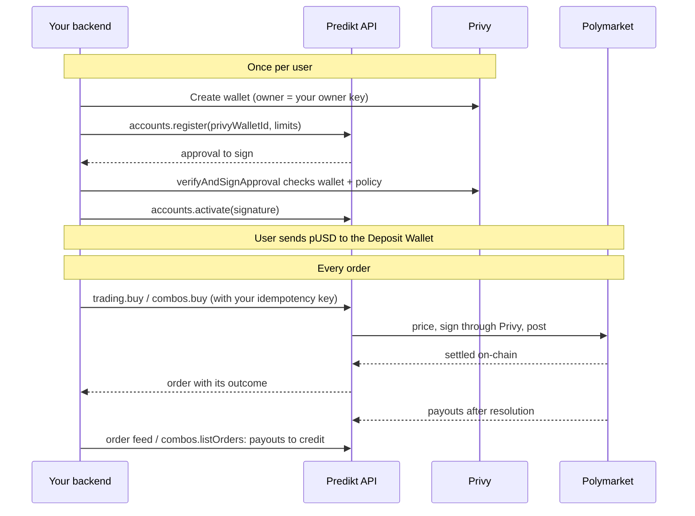

# Integration guide

A step-by-step guide for developers integrating Predikt with `@prediktgg/sdk`. It covers everything the SDK does: market data, user-signed trading across Polymarket and Limitless, and server-side trading on Privy wallets (direct Polymarket orders and Polymarket Combos). Follow the part that matches your product. For every method, type and error code see the [README](https://github.com/4-point-0/predikt-sdk#readme); for the REST reference see the Predikt documentation.

## Contents

1. [Choose your integration model](#1-choose-your-integration-model)
2. [Set up the SDK](#2-set-up-the-sdk)
3. [Market data (both models)](#3-market-data-both-models)
4. [Model A: user-signed trading](#4-model-a-user-signed-trading)
5. [Model B: server-side trading on Privy wallets](#5-model-b-server-side-trading-on-privy-wallets)
6. [Errors and retries](#6-errors-and-retries)
7. [Go-live checklists](#7-go-live-checklists)

## 1. Choose your integration model

Predikt offers two ways to trade. Market data works the same for both.

| | **Model A: user-signed trading** | **Model B: server-side on Privy wallets** |
| --- | --- | --- |
| Who signs | The user's own wallet, for every transaction | Predikt, through a signer on a Privy wallet **you** own, within limits you approve |
| User funds | USDC on Sui (default) or Solana | pUSD on Polygon, in the user's Polymarket Deposit Wallet |
| Venues | Polymarket and Limitless (Kalshi: simulation only) | Polymarket: single outcomes (direct trading) and Combos (parlays) |
| How it works | Predikt bridges the funds, fills on the venue and mints synthetic position tokens on the user's chain | Orders are placed on Polymarket straight from the Deposit Wallet; no bridge |
| Auth | API key + wallet sign-in (JWT) per user | **Backend** API key only, no JWT |
| Runs in | Browser, app or backend | **Your backend only** |
| SDK clients | `auth`, `buy`, `sell`, `redeem`, `orders`, `positions`, `users` | `privyApp`, `accounts`, `trading`, `combos` |

Choose **Model A** if your users connect their own Sui or Solana wallet. Choose **Model B** if you hold your users' wallets in Privy (for example a casino or a custodial app) and want to trade for them from your servers.

## 2. Set up the SDK

**Requirements:** Node.js 18+ (or any modern browser for Model A and market data); the latest 22.x or 24.x LTS release is recommended, since Node.js 18 and 20 are end-of-life and get no security fixes. TypeScript 5+ recommended.

```bash
npm install @prediktgg/sdk
```

```typescript
import { PrediktSDK } from '@prediktgg/sdk';

export const predikt = new PrediktSDK({
  baseUrl: process.env.PREDIKT_API_URL!,   // API origin, no trailing slash
  apiKey: process.env.PREDIKT_API_KEY!,    // sent as x-api-key on every request
  timeoutMs: 60_000,                       // optional; no timeout by default
});
```

**API keys.** Request one from Predikt. A **frontend** key is meant for browsers and works on every route except Model B's. A **backend** key is for your servers and is **required** for Model B. Rate limits are per integrator, shared by all your keys (60 requests per minute by default; read the `X-RateLimit-*` headers).

**Units.** Get these right first; they are the most common source of bugs.

| Value | Format | Example |
| --- | --- | --- |
| USDC amounts in Model A requests and orders | 6-decimal integer string | `"10000000"` = 10 USDC |
| Market prices (`yesAsk`, `yesBid`, `noAsk`, `noBid`) and price history `p` | Integer **cents** 0–100 | `58` = 0.58 |
| Simulation results (`totalCost`, `totalContracts`, `averagePrice`) | Human-unit decimal string | `"10.000000"`, `"0.580000"` |
| Order limits (`maxPrice`, `minPrice`) | Decimal string | `"0.59000"` |
| pUSD amounts and shares in Model B | 6-decimal integer string | `"2000000"` = 2 pUSD or 2 shares |
| Prices in Model B | Decimal string between 0 and 1 | `"0.41"` |
| `outcome` | Integer | `0` = YES, `1` = NO |

Never convert 6-decimal strings to a JavaScript `number`; use `toBaseUnits('2.5')` → `"2500000"` and `fromBaseUnits('2500000')` → `"2.5"`.

## 3. Market data (both models)

Market data needs only the API key.

**Browse markets.** Results are groups: one group per question, holding the matching market of each venue.

```typescript
import { MarketSortOption, PlatformType, SortOrder } from '@prediktgg/sdk';

const result = await predikt.markets.list({
  search: 'fed',
  platforms: [PlatformType.POLYMARKET, PlatformType.LIMITLESS],
  sort: MarketSortOption.VOLUME,
  sortOrder: SortOrder.DESC,
  page: 1,
  limit: 20,                         // max 200
});

for (const group of result.data.markets) {
  for (const market of group.markets) {
    // market.id (Predikt id), market.platform, market.ticker, market.yesAsk (cents)
  }
}
// result.pagination: { currentPage, itemsPerPage, totalItems, totalPages, hasNext, hasPrev }
```

**One group or market:**

```typescript
const group = await predikt.markets.get(marketId);            // any member market id or matched-market id
group.bestOdds.marketBestOddsForYes;                           // member market with the best YES price

const details = await predikt.markets.getMarket(marketId);    // one venue market + its match group
```

Which identifier to use where:

| You want to | Use |
| --- | --- |
| Show a market, its price history, or link to it | `market.id` |
| Trade it in Model A | `market.ticker` + `market.platform` (as `source`) |
| Trade it directly in Model B | Polymarket's outcome `tokenId`: look it up on Polymarket's Gamma API with `market.platformMarketId` (`GET https://gamma-api.polymarket.com/markets/<platformMarketId>` → `clobTokenIds`, in the order of `outcomes`) |
| Use it as a Combo leg | `marketId` from `predikt.combos.listMarkets()` (Polymarket's market id, the same value as `platformMarketId`) |

**Price history (charts):**

```typescript
const history = await predikt.priceHistory.forMarket(marketId, { interval: '1d' });
history.yes;   // [{ t: unixSeconds, p: cents }]
```

**Live prices (WebSocket):** subscribe to the market ids visible on screen; every `subscribe` call replaces the list.

```typescript
predikt.ws.connect(process.env.PREDIKT_WS_URL!);
predikt.ws.on('open', () => predikt.ws.subscribe(visibleMarketIds));
predikt.ws.on('market_update', (event) => {
  for (const change of event.changes) updateMarket(event.marketId, change.field, change.newValue);
});
```

**Venue status (Model A):** disable buy and sell buttons for a paused venue.

```typescript
const venues = await predikt.venues.getStatus();   // [{ platform, isTradingEnabled, statusMessage }]
```

## 4. Model A: user-signed trading

Every call below acts for one signed-in user. The SDK keeps the user's JWT and sends it automatically. Route these calls through your backend if you can, and keep tokens server-side.

### 4.1 Sign the user in

```typescript
import { WalletChain } from '@prediktgg/sdk';

const { nonce, message, isNewUser } = await predikt.auth.getChallenge(walletAddress, WalletChain.SUI);
const signature = await signWithWallet(message);         // your wallet adapter (Sui Wallet, Phantom, ...)
const { access_token } = await predikt.auth.verify({
  walletAddress,
  chain: WalletChain.SUI,                               // or WalletChain.SOLANA
  nonce,
  signature,
  referralCode: isNewUser ? referralCode : undefined,   // optional, first sign-in only
});
// Persist access_token if your app reloads; restore it with predikt.setToken(token). Log out with predikt.clearToken().
```

The nonce is valid for about 5 minutes. Use the same `walletAddress` spelling everywhere.

### 4.2 Buy

```
simulate → create order → user signs transaction.bytes → link the hash → poll until SETTLED
```

```typescript
import { BuyOrderStatus, Outcome, PlatformType, SourceChain } from '@prediktgg/sdk';

// 1. Simulate: may return every matched venue plus the best one.
const sim = await predikt.buy.simulate({
  platform: PlatformType.POLYMARKET,
  ticker: market.ticker,
  outcome: Outcome.YES,
  usdcAmount: '10000000',                 // 10 USDC
});
// Pick an executable venue: Kalshi can be simulated but not executed yet.
const source =
  sim.bestPlatform && sim.bestPlatform !== PlatformType.KALSHI ? sim.bestPlatform : PlatformType.POLYMARKET;
// sim.polymarket?.averagePrice, sim.polymarket?.totalContracts, sim.feeBps (your fee in bps)

// 2. Create the order: the wallet comes from the JWT.
const { order, transaction, quote } = await predikt.buy.createOrder({
  ticker: market.ticker,
  source,
  outcome: Outcome.YES,
  usdcAmount: '10000000',
  sourceChain: SourceChain.SUI,           // default; SourceChain.SOLANA for Solana
  slippagePercent: 2.5,                   // minimum and default 2.5
});

// 3. The user signs and submits transaction.bytes (base64) with their wallet.
const bridgeTxHash = await signAndSubmit(transaction.bytes);

// 4. Link it (Sui and Solana alike).
await predikt.buy.setTxHash(order.id, bridgeTxHash);

// 5. Poll until final.
let current = await predikt.orders.getBuyOrder(order.id);
while (current.status !== BuyOrderStatus.SETTLED && current.status !== BuyOrderStatus.FAILED) {
  await new Promise((r) => setTimeout(r, 3000));
  current = await predikt.orders.getBuyOrder(order.id);
}
```

- On `SETTLED`, the user holds **synthetic position tokens** on their own chain, and the position appears in `predikt.positions.list`. Bridging alone is not success: wait for `SETTLED`.
- On `FAILED` after bridging, the USDC is refunded to the user's chain automatically (`errorMessage` says so).
- A buy left `PENDING` without a linked transaction is deleted after about an hour.
- Check `predikt.venues.getStatus()` first: a disabled venue gets `409 VENUE_TRADING_DISABLED`.

Lifecycle: `PENDING → EXECUTING → SETTLED | FAILED`.

### 4.3 Sell and redeem

```typescript
const { order: sell, transaction: sellTx } = await predikt.sell.createOrder({
  ticker: market.ticker,
  source: PlatformType.POLYMARKET,
  outcome: Outcome.YES,
  positionAmount: '5000000',              // tokens to sell, 6 decimals
  isPartial: true,
  slippagePercent: 2.5,
  sourceChain: SourceChain.SUI,
});
const sellSignature = await signAndSubmit(sellTx.bytes);
// Sui: nothing more, the chain event is picked up. Solana: link it.
await predikt.sell.setSolanaTx(sell.id, sellSignature);         // Solana only

// After the market resolves, redeem winning tokens (no simulation):
const { order: redeem, transaction: redeemTx } = await predikt.redeem.createOrder({
  ticker: market.ticker,
  source: PlatformType.POLYMARKET,
  outcome: Outcome.YES,                   // omit amount for the full balance
});
const redeemSignature = await signAndSubmit(redeemTx.bytes);
await predikt.redeem.setSolanaTx(redeem.id, redeemSignature);   // Solana only; returns { order }
```

Lifecycles: sell `PENDING → EXECUTING → SOLD → BRIDGING → SETTLED | FAILED`, redeem `PENDING → EXECUTING → BRIDGING → SETTLED | FAILED`. Poll `predikt.orders.getSellOrder` / `getRedeemOrder`.

### 4.4 Batches (optional)

`predikt.buy.createBatch(items)` buys 2–10 markets in one flow and returns **one transaction per venue** (`transactions[]`, each with a `groupId`). After signing each, call `predikt.buy.setBatchTxHashes(batchId, [{ groupId, txHash }])`. `predikt.sell.createBatch(items)` sells 2–10 positions (max 3 on Solana) in **one** transaction; on Solana link it with `predikt.sell.setBatchChainTx(batchId, signature)`.

### 4.5 Orders, positions and referrals

```typescript
// Order history: { items, total }, newest first, offset pagination
const { items, total } = await predikt.orders.listBuyOrders({ limit: 20, offset: 0 });

// Portfolio
import { PositionStatus } from '@prediktgg/sdk';
const portfolio = await predikt.positions.list({ userAddress: walletAddress, status: PositionStatus.OPEN });
for (const p of portfolio.data.positions) {
  // p.ticker, p.shares, p.value, p.pnl (a percentage, not dollars)
}

// Referrals
const referral = await predikt.users.getReferralInfo();   // referralCode, referredByCode, referralCount
```

> [!NOTE]
> The SDK supports Sui and Solana for Model A. The Arbitrum source chain (`sourceChain: "23"`, EVM transactions) is available through the REST API but is not typed in the SDK yet.

## 5. Model B: server-side trading on Privy wallets

> [!IMPORTANT]
> Model B runs **only on your server**. It needs a **backend** API key, your Privy App Secret and your owner key. Never ship any of them to a browser or mobile app.

### 5.1 What you need

| Item | Where it comes from | Notes |
| --- | --- | --- |
| Predikt **backend** API key | Predikt | A frontend key gets `403 FORBIDDEN` on these routes |
| Privy app: **App ID** and **App Secret** | Privy dashboard | Send the App Secret to Predikt through the agreed secure channel. Until Predikt has configured it, calls return `500 INTERNAL_ERROR` |
| **Owner key**: a Privy authorization key (P-256), registered as a key quorum | Privy dashboard → authorization keys | The private key (`wallet-auth:...`) stays on your server. It owns every user wallet and signs approvals |

### 5.2 How it fits together



- The **Privy wallet** is yours. Predikt gets an additional signer on it, limited by a Privy policy to Polymarket logins, Polymarket orders and Deposit Wallet batches, until the grant's `expiresAt`.
- The **Deposit Wallet** is Polymarket's smart wallet for that Privy wallet. It holds the user's pUSD and positions. **Users fund this address**, not the Privy wallet.
- Predikt never holds funds. Removing Predikt's signer from the wallet in Privy revokes access immediately.

### 5.3 Connect your Privy app (once)

```typescript
await predikt.privyApp.connect({ appId: process.env.PRIVY_APP_ID!, environment: 'production' });
const app = await predikt.privyApp.get();   // { appId, environment, status: 'active' }
```

### 5.4 Onboard a user's wallet (once per user)

First create the Privy wallet with Privy's server SDK or REST API: an Ethereum wallet whose `owner_id` is **your owner key quorum id**. Then:

```typescript
import { verifyAndSignApproval } from '@prediktgg/sdk/server';

const limits = {
  maxBuyAmountPerOrder: '50000000',        // max 50 pUSD per buy
  expiresAt: '2027-06-30T00:00:00Z',       // grant expiry
};

let account = await predikt.accounts.register({ privyWalletId, ...limits });

if (account.status === 'awaiting_owner_approval') {
  // Checks the approval against Privy itself, then signs it locally with your owner key.
  // Throws ApprovalVerificationError (and signs nothing) if anything is off.
  const signed = await verifyAndSignApproval(account, {
    ownerKey: process.env.PRIVY_OWNER_KEY!,     // "wallet-auth:..." or PEM
    privyAppId: process.env.PRIVY_APP_ID!,
    privyAppSecret: process.env.PRIVY_APP_SECRET!,
    expected: { privyWalletId, ...limits },
  });
  account = await predikt.accounts.activate(account, signed);
}

// account.status === 'active'
await db.users.update(userId, {
  prediktAccountId: account.accountId,               // direct trading
  depositWalletAddress: account.depositWalletAddress, // combos and funding
});
```

| `status` | Meaning | What to do |
| --- | --- | --- |
| `provisioning` | Deposit Wallet still deploying (only if `register` stopped waiting after 2 min) | Call `register` again with the same input |
| `awaiting_owner_approval` | Approval ready, valid for 10 minutes | Verify, sign, activate (as above) |
| `active` | Ready to trade | — |
| `unavailable` | Grant expired, or account suspended | Re-authorize ([5.9](#59-renewing-and-changing-limits)); a suspended account needs Predikt |

> [!WARNING]
> Never sign an approval without `verifyAndSignApproval` (or the same checks done yourself). It is what guarantees that Predikt only gets the narrow, time-limited signer you agreed to.

**What you approve.** Until `expiresAt`, Predikt can sign Polymarket logins and orders, and Deposit Wallet batches with unrestricted inner calls (used for approvals, redemptions and withdrawals; Predikt only ever sends withdrawals to your own Privy wallet, a limit Predikt enforces, not the policy). Treat the grant as broad control of the Deposit Wallet's funds for its duration. Predikt checks `maxBuyAmountPerOrder` before signing every buy; for combos it applies to the amount before fees, so the fee (around 3%) can come on top.

### 5.5 Fund the Deposit Wallet

Show the user `depositWalletAddress` and ask for **pUSD on Polygon**:

```typescript
const portfolio = await predikt.accounts.portfolio(account);
portfolio.balances.pusd;    // tradable, exact on-chain (base units)
portfolio.balances.usdce;   // USDC.e sent by mistake: visible, but not tradable
portfolio.positions;        // regular positions (combos: predikt.combos.positions)
```

**Withdraw.** Moves pUSD from the Deposit Wallet to the account's own **Privy wallet** (the wallet you registered). That is the only possible destination; it cannot be set in the request. From there you move the funds with Privy as usual.

```typescript
const withdrawal = await predikt.trading.withdraw(account, {
  amount: 'all',                              // or base units, e.g. '5000000'
  idempotencyKey: `withdraw-${myWithdrawal.id}`,
});
const done = await predikt.trading.waitForOrder(account, withdrawal);
if (done.status === 'withdrawn') {
  // done.amount: exact pUSD moved; done.transactionHashes[0]: the Polygon transfer
}
```

No fees, and any active, unexpired grant allows it. `400 NOTHING_TO_WITHDRAW` / `400 INSUFFICIENT_BALANCE` mean nothing was recorded; `409 WITHDRAWAL_REJECTED` means the relayer refused and nothing moved. Do not withdraw funds you still hold reserved for `submitted` or `unknown` orders.

### 5.6 Direct trading (single Polymarket outcomes)

Orders are **fill-or-kill**: fully filled at or better than the limit price, or nothing.

```typescript
const buy = await predikt.trading.buy(account, {
  tokenId,                              // Polymarket CLOB outcome token id (see section 3)
  amount: '2000000',                    // all-in pUSD incl. fees; at least ~1.05 pUSD
  slippagePercent: '5',                 // optional, '0.1'–'50', default '5'
  idempotencyKey: `buy-${myOrder.id}`,  // 8–128 chars [A-Za-z0-9_-]; store it first
});

const settled = await predikt.trading.waitForOrder(account, buy, { timeoutMs: 120_000 });
if (settled.status === 'filled') await debitUser(settled.spentAmount!);   // not `amount`
else if (settled.status === 'rejected') await releaseReservation();      // settled.reasonCode says why
else keepReservedAndCheckLater(settled);                                  // 'submitted' / 'unknown'

const sell = await predikt.trading.sell(account, {
  tokenId,
  shares: 'all',                        // base units or "all"
  idempotencyKey: `sell-${mySale.id}`,
});
const sold = await predikt.trading.waitForOrder(account, sell);
if (sold.status === 'filled') await creditUser(sold.receivedAmount!);   // net of fees
```

| `status` | Final | What to do |
| --- | --- | --- |
| `filled` | Yes, once amounts are set | Settle: debit `spentAmount` (buy), credit `receivedAmount` (sell) |
| `redeemed` | Yes | Credit `receivedAmount` |
| `withdrawn` | Yes | Withdrawal settled: `amount` pUSD is in your Privy wallet |
| `rejected` | Yes | Release; nothing moved. Retry only with a **new** key |
| `pending`, `submitting`, `submitted` | No | Keep reserved; poll |
| `unknown` | No | Keep reserved; poll; **never** place a replacement |

Predikt checks unsettled orders against the chain for up to 24 hours; one with no settlement after an hour becomes `rejected` (`NOT_FILLED_ONCHAIN`).

**Order change feed.** New orders, status changes and **Polymarket's automatic redemptions** (which appear only here). Store the cursor and run it from a job:

```typescript
let cursor = await loadCursor(account.accountId);
for await (const page of predikt.trading.iterateOrderChanges(account, { cursor })) {
  for (const order of page.orders) await applyOnce(order);   // the same order can appear again
  if (page.nextCursor) await saveCursor(account.accountId, (cursor = page.nextCursor));
}
```

Polymarket redeems resolved positions on its own; Predikt records each as `side: 'redeem'`, `source: 'polymarket_auto'`. `predikt.trading.redeem(account, { conditionId, idempotencyKey })` is only a fallback.

### 5.7 Polymarket Combos

A combo is one ticket over 2–50 legs (a market and an outcome) that pays 1 pUSD per share only if every leg wins. Prices come from market makers.

**Check the account can trade combos** (after onboarding and after every re-authorization):

```typescript
const current = await predikt.accounts.get(account);
if (current.activeGrant?.combosEnabled !== true) {
  // null or false: re-authorize once (5.9); combo buys would end FAILED / SIGNING_FAILED
}
```

**Markets and an indicative price:**

```typescript
import type { ComboLeg } from '@prediktgg/sdk';

const { markets } = await predikt.combos.listMarkets({ limit: 100 });   // m.marketId, m.outcomes, m.prices
const legs: ComboLeg[] = [
  { marketId: '682708', outcome: 0 },    // 0 = first outcome (usually Yes)
  { marketId: '1090496', outcome: 1 },
];
const quote = await predikt.combos.quote({ legs, amount: '2000000' });
quote.indicativePrice;   // product of the leg prices; not binding
quote.potentialPayout;   // pUSD paid if every leg wins
```

**Buy.** Reserve the funds and store a `clientOrderId` first:

```typescript
const clientOrderId = `combo-${myOrder.id}`;           // 1–100 chars, unique per order
const maxPrice = Math.min(Number(quote.indicativePrice) * 1.1, 1).toFixed(4);  // max price per share incl. fees

const order = await predikt.combos.buy({
  wallet: account,                    // or the stored depositWalletAddress
  legs,
  amount: '2000000',                  // pUSD budget incl. fees; never exceeded
  maxPrice,
  clientOrderId,
});
// FILLED → debit order.amount, store order.comboConditionId
// FAILED → release; order.error.code says why
// EXECUTING / PENDING → keep reserved, then:
const latest = await predikt.combos.waitForOrder(order, { timeoutMs: 120_000 });
```

| `status` | Final | What to do |
| --- | --- | --- |
| `PENDING` | No | Poll |
| `EXECUTING` | No | Keep reserved; poll `combos.getOrder`. **Never place a replacement** |
| `FILLED` | Yes | Settle with `amount` |
| `FAILED` | Yes | Release; retry only with a **new** `clientOrderId` |

> [!CAUTION]
> A `FAILED` combo can still carry `quotedPrice`, `shares` and `amount` from the quote that was refused. Only ever use the amounts of `FILLED` orders. And branch on `status`, not the HTTP code: a `FAILED` order is still returned with `201`.

Quotes succeed more often with legs priced around 0.4–0.6 from **unrelated** events; two markets of the same event tend to get `CONTRADICTORY_LEGS`. `NO_QUOTES` is not permanent: the same ticket often fills a minute later (with a new `clientOrderId`).

**Cash out (optional):**

```typescript
const sale = await predikt.combos.sell({
  wallet: account,
  comboConditionId: boughtOrder.comboConditionId!,
  shares: boughtOrder.shares!,            // base units
  minPrice: '0.30',                       // min net price per share after fees
  clientOrderId: `combo-sell-${mySale.id}`,
});
// FILLED → credit sale.amount
```

**Payouts.** When every leg has resolved, Polymarket pays winning combos into the Deposit Wallet automatically. Predikt records each payout within about 10 minutes as a combo order with `direction: 'REDEEM'`, `status: 'FILLED'`, `source: 'POLYMARKET_AUTO'`. `listOrders` is newest first and is not a change feed, so run a job that processes order ids you have not seen yet:

```typescript
const page = await predikt.combos.listOrders({ wallet: account, status: 'FILLED', limit: 100 });
for (const o of page.data) {
  if (o.direction === 'REDEEM' && !(await db.processed.has(o.id))) {
    await creditUser(o.wallet, o.amount!);   // once per order id
    await db.processed.add(o.id);
  }
}
```

If a combo shows as redeemable (`predikt.combos.positions({ wallet: account, status: 'REDEEMABLE' })`) but no payout appeared after a while, call the fallback `predikt.combos.redeem({ wallet: account, comboConditionId, clientOrderId })`.

### 5.8 Accounting

Process each order id **exactly once**.

| Event | Source of truth |
| --- | --- |
| Direct buy debit | `spentAmount` of the `filled` buy |
| Direct sell credit | `receivedAmount` of the `filled` sell |
| Direct payout | `receivedAmount` of `redeemed` orders, **both** sources (`integrator`, `polymarket_auto`) |
| Withdrawal | `amount` of the `withdrawn` withdraw order |
| Combo buy debit | `amount` of the `FILLED` BUY |
| Combo cash-out credit | `amount` of the `FILLED` SELL |
| Combo payout | `amount` of `FILLED` REDEEM orders, **both** sources (`API`, `POLYMARKET_AUTO`) |

**Rules your code must follow:**

1. Store the `idempotencyKey` / `clientOrderId` **before** calling. Repeating a request with it never trades twice.
2. Outcome unknown (timeout, crash, network error): repeat with the **same** key, never a new one.
3. A **new** key only after `rejected` / `FAILED`.
4. Never replace an `unknown` (direct) or `EXECUTING` (combo) order: it may still fill.
5. Settle only from final orders, once per order id; credit payouts of both sources.

### 5.9 Renewing and changing limits

Re-authorize to change `maxBuyAmountPerOrder`, to renew before (or after) `expiresAt`, and once for accounts whose `activeGrant.combosEnabled` is not `true`:

```typescript
import { isReauthorizationPending } from '@prediktgg/sdk';

const next = { maxBuyAmountPerOrder: '100000000', expiresAt: '2028-01-01T00:00:00Z' };
const pending = await predikt.accounts.reauthorize(account, next);
const signed = await verifyAndSignApproval(pending, {
  ownerKey: process.env.PRIVY_OWNER_KEY!,
  privyAppId: process.env.PRIVY_APP_ID!,
  privyAppSecret: process.env.PRIVY_APP_SECRET!,
  expected: { privyWalletId, ...next },
});
await predikt.accounts.activate(pending, signed);
```

The account keeps trading under its old limits until you activate; `isReauthorizationPending(account)` tells you a new approval is waiting. Set a reminder well before `expiresAt`: after it, every trade fails until you re-authorize.

## 6. Errors and retries

Every API error is thrown as a `PrediktApiError` subclass with `status`, `code` and `message`. **Branch on `code`**, never on `message`.

| Class | HTTP | Typical cause |
| --- | --- | --- |
| `PrediktValidationError` | 400 | Bad input (`BAD_REQUEST`, `ORDER_TOO_SMALL`, ...) |
| `PrediktAuthError` | 401 / 403 | Model A: token missing or expired (sign in again). Model B: frontend key, no active grant, wallet not yours |
| `PrediktNotFoundError` | 404 | Unknown id, or not owned by the user |
| `PrediktConflictError` | 409 | State conflict (`VENUE_TRADING_DISABLED`, `IDEMPOTENCY_KEY_REUSED`, `COMBO_CLIENT_ORDER_ID_REUSED`, ...) |
| `PrediktRateLimitError` | 429 | Too many requests: wait `err.retryAfter` seconds (a minute for the combo limit of 15 buys or sells per wallet) |
| `PrediktInternalError` | 500 | Unexpected failure, including an unconfigured App Secret or Polymarket being unavailable on combo calls |
| `PrediktServiceUnavailableError` | 503 | A provider (Privy, Polymarket) is down on direct trading; see `err.retryable` |

Errors may carry `err.details`; `err.orderId` means an order was recorded before the error (check it instead of placing a new one), and `err.retryable` says whether repeating can help.

**Automatic retries (Model B only).** For `privyApp`, `accounts`, `trading` and `combos`, the SDK repeats the **same** request (same key) on network errors, timeouts, `5xx` errors marked retryable without an `orderId`, and `409 TRADING_APPROVALS_PENDING` (a wallet's first trade; for direct orders the repeat returns a `rejected` order to place again with a new key). Turn it off with `retry: false`. Model A and market-data calls are never retried automatically.

Network failures (no response) throw the native `TypeError` from `fetch`; a `timeoutMs` timeout throws `TimeoutError`. In Model B, treat both as "outcome unknown" and repeat with the same key.

The full code lists are in the [README](https://github.com/4-point-0/predikt-sdk#error-handling) and the Predikt documentation.

## 7. Go-live checklists

**Model A: user-signed trading**

- [ ] API key not exposed beyond what you intend (frontend key in browsers only).
- [ ] Sign-in with the same `walletAddress` spelling in challenge, verify and every later call.
- [ ] Amounts sent as 6-decimal strings; `outcome` 0 = YES, 1 = NO; market prices read as cents.
- [ ] Venue status checked before showing trade buttons.
- [ ] Buys tracked until `SETTLED` or `FAILED`, not just until the bridge transaction is linked.
- [ ] Solana sells and redeems linked with `setSolanaTx`.
- [ ] Portfolio refreshed after settlement; `pnl` shown as a percentage.

**Model B: server-side on Privy wallets**

- [ ] Backend API key, App Secret and owner key only on the server; owner key never logged.
- [ ] Privy app connected (`privyApp.get()` returns `active`) in production.
- [ ] Wallets created with your owner key as `owner_id`; approvals signed only through `verifyAndSignApproval`.
- [ ] `accountId` and `depositWalletAddress` stored per user; users fund the Deposit Wallet with pUSD on Polygon.
- [ ] Idempotency keys stored before every order; same key on retry, new key only after `rejected` / `FAILED`.
- [ ] `unknown` / `EXECUTING` orders tracked by a background job, never replaced.
- [ ] Debits and credits only from final orders, once per order id; payouts of both sources credited.
- [ ] Direct order change-feed cursor persisted; combo payout job running.
- [ ] `activeGrant.combosEnabled === true` before offering combos.
- [ ] Payouts tested end to end with a small position that resolved.
- [ ] Reminder to re-authorize before `expiresAt`.
- [ ] HTTP timeout of at least 60 seconds.
